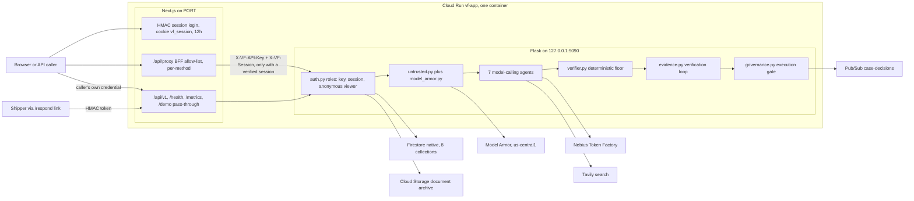
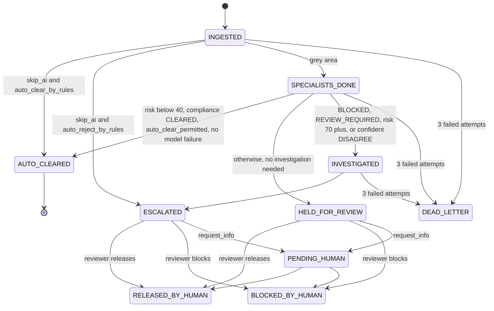
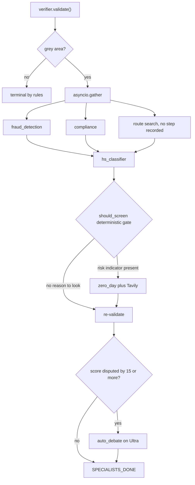
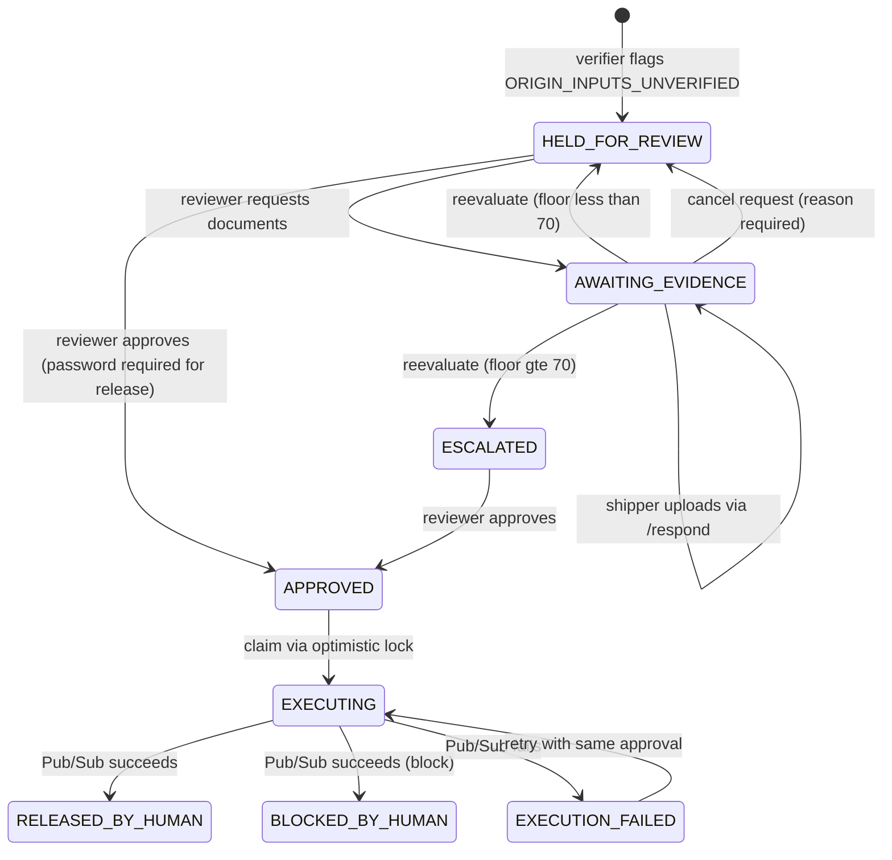

# Architecture

Floorline screens freight shipments for fraud and sanctions exposure, and acts on
what it finds without asking a human per shipment. (VF Logistics is the operator in the
demo; the repository, the Cloud Run service `vf-app` and the API's service name keep
that name.) It runs on Google Cloud for
infrastructure and on Nebius Token Factory for inference. No Google AI model is used
anywhere; `requirements.txt` carries only `google-cloud-firestore`,
`google-cloud-pubsub` and `google-cloud-storage`.

This document is written from the code, not from the docstrings. Where a docstring
disagrees with the code it describes, the code wins and the disagreement is noted.

---

## The load-bearing idea

Three different questions, answered by three different mechanisms, deliberately kept
apart:

| Question | Answered by | Can it lower risk? |
| --- | --- | --- |
| What is *true* about this shipment? | agents, on Nemotron | no |
| What is *proven*? | `verifier.py`, arithmetic and list lookups only | it sets the floor |
| What may be *done* about it? | the published delegation boundary | it refuses, never invents |

An agent finding is a claim until something deterministic agrees with it. Authority is
granted by publication, not earned by reasoning well.

---

## Deployment topology



Region is `asia-southeast1` throughout, except Model Armor which is configured at
`us-central1`.

One image, two processes. `entrypoint.sh` starts gunicorn on `127.0.0.1:9090`, waits
for `/health`, then starts Next.js on `$PORT`, the only port Cloud Run routes to, so
Flask is reachable only through Next. Two doors lead in, and they differ in whose
credential travels: `/api/proxy/*` is the console's backend-for-frontend, allow-listed
in `frontend/src/lib/proxy-policy.ts` and the only place the console's key is attached;
`/api/v1/*`, `/health`, `/metrics` and `/demo` are the public API, passed through by
`frontend/src/lib/upstream.ts` with the caller's own credential and nothing added.

### Why the console has its own login and not Cloud IAP

IAP was the first choice and is not available on this project. It needs an OAuth
consent screen, and creating one requires the Google Cloud project to belong to an
organisation -- `gcloud iap oauth-brands list` answers *"Project must belong to an
organization"*. The older brand API that could have worked around it was shut down in
March 2026.

Setting `iapEnabled` on the Cloud Run service without a consent screen does not fail
loudly. It serves an empty HTTP 502 to every visitor. That is how this was discovered,
and it is why `frontend/src/lib/session.ts` exists.

So the console signs its own sessions with HMAC over `VF_SESSION_SECRET`. That is a
smaller trust base than IAP -- our HMAC rather than Google's -- and the tradeoff is
accepted deliberately, because the alternative on this project is no login at all.

### What the login replaced

Before it, every visitor to the deployed console was a `GOVERNANCE_ADMIN`. The proxy
attaches `VF_API_KEY` server-side to every forwarded request, a valid key grants
`GOVERNANCE_ADMIN` upstream, and there was nothing in front of it. Measured against
the live service with no credential of any kind:

```
GET https://vf-console-.../api/proxy/billing/usage   -> 200   data returned
GET https://vf-logistics-.../api/v1/billing/usage    -> 403   backend refuses
```

(Those were the two services this deployment then had; they have since merged into
`vf-app`.) The backend authorisation was right. The console defeated it.

### What replaced the lent key

The login closed writes and, for a while, left reads lent the key: an anonymous GET
still carried `VF_API_KEY` upstream, so an anonymous reader held `governance_admin` on
every read, and every signed-in person held it on everything. Roles were decorative.

Now the key travels **only alongside a session that verifies**, and a session can only
narrow what the key grants. `auth._api_key_context` resolves four cases:

| Caller presents | Resolved as |
| --- | --- |
| nothing | `ANONYMOUS_ROLE`, `viewer` here |
| the key alone | `governance_admin`, a service identity (the scripts) |
| the key and a verified session | the person's role from `ADMIN_EMAILS` / `OPERATOR_EMAILS` / `REVIEWER_EMAILS`, capped at what the key grants; unlisted is `viewer` |
| the key and a session that fails to verify | **401**, never a fallback to admin |

Each route declares its role by decorator, and `GET /api/v1/auth/policy` reads the table
back from the running routes: 6 public, 25 viewer, 10 reviewer, 24 operator, 5
governance admin (70 routes). `GET /api/v1/auth/whoami` says what the caller resolved to, and the
console renders every role-dependent control from that answer. Measured on the live
service after the change:

```
GET  /api/v1/review/queue              anonymous      -> 200   viewer, by design
GET  /api/proxy/billing/usage          anonymous      -> 403   operator
POST /api/proxy/review/<id>/decide     anonymous      -> 403   reviewer
GET  /api/v1/auth/whoami               key + forged session -> 401
GET  /api/proxy/billing/usage          reviewer session     -> 403
GET  /api/proxy/billing/usage          admin session        -> 200
```

The review queue moved to `viewer` on purpose: it is a filtered view of cases that
`/orchestrator/state` already serves a viewer, so gating it protected nothing and was the
reason the console lent its key to anonymous reads in the first place.

`VF_PUBLIC_READS` still defaults to false, so a deployment that forgets it is locked,
not open. It is on here for a stated reason, the judging window, over synthetic data.
**Anonymous reads must be turned off before a paying customer's data is in the store.**

The proxy also refuses every write without a verified session, before the backend is
asked, so an anonymous `POST /api/proxy/governance/simulate` is 401 even though the
route itself is `viewer`: the dry run reads nothing a viewer cannot, but a write-shaped
request from nobody is refused at the first door.

### One-click sign-in, and what it cannot do

The console can offer judges a **one-click** sign-in (`POST /api/auth/judge`, off unless
`VF_ONE_CLICK_JUDGE=true`, closed after `VF_ONE_CLICK_UNTIL`). It mints an ordinary
session for a dedicated guest account, and the role still comes from the API's lists --
the console asserts an email, never a role.

What differs is a signed `amr` claim in the session body: `password` from the login
form, `one_click` from the button. Because the button is public and its account is an
admin, role alone cannot protect the actions a stranger could take that the next
visitor would find undone. Six routes therefore also ask how the session was signed
in: `POST /orchestrator/reset` (Clear board), `POST /governance/publish` (which replaces
the shared boundary, and suspends the agent if it permits nothing),
`POST /governance/revoke` (which suspends the agent until someone re-publishes),
`PUT /governance/prefilter-rules` (which decides what clears with no model at all), and
the verification loop's `POST /review/<id>/approve` and `POST /review/<id>/execute`
(which release or block cargo). Simulating a boundary stays open to the judge. Separately,
`human_decide` behind `/decide` refuses a release from any caller whose sign-in is not a
password (see *Policy gate (N07)* below); a block is allowed.

| Caller | The six routes |
| --- | --- |
| password session with the route's role | allowed |
| one-click session, any role | **403**, `required_auth: "password"` |
| session with no or an unknown `amr` (e.g. minted before the claim) | **403**, fails closed |
| API key alone (scripts, seeding) | allowed -- no session to ask about |

It is checked in the BFF (`PASSWORD_ONLY_POST` and `PASSWORD_ONLY_PUT`, so the refusal
costs no upstream call) and again in Flask (`auth.require_password_session`, stacked
under the role decorator and published as `requires_password_session` in
`/auth/policy`). The route counts above are unchanged: it is a flag on a route, not a
sixth role, because "admin minus six routes" is not nested inside anything and the
hierarchy relies on roles being nested.

A reset clears cases and events and keeps the audit trail, and writes a `board_reset`
row naming the actor and `actor_auth`. Review decisions, boundary publishes and revokes,
and pre-filter edits record `actor_auth` too, so the Audit Trail tags what was done from
the guest session.

---

## How a case enters

Six ways, all `@require_operator`:

| Route | Mechanism |
| --- | --- |
| `POST /api/v1/events/shipment` | bare JSON or a Pub/Sub push envelope, auto-detected |
| `POST /api/v1/events/document` | multipart upload, PDF/PNG/JPG/WEBP, 20 MB cap |
| `POST /api/v1/events/storage` | Pub/Sub push from a GCS object-finalize notification |
| `POST /api/v1/ingest/bucket-sweep` | batch sweep of already-staged objects, 25 max |
| `POST /api/v1/simulate`, `/simulate/bulk` | synthetic injection |
| `POST /api/v1/compliance/audit` | the B2B contract surface, idempotent on `client_reference` |

Two things a reader usually gets wrong:

**Pub/Sub push arrives over authenticated HTTP, not a subscriber client.** The
subscription must send `X-VF-API-Key` or deliveries 403. `/events/storage` always
returns 200 even on error, to stop redelivery, and logs instead.

**Six more routes call agents without creating a case at all** --
`/fraud/analyze`, `/fraud/batch`, `/compliance/screen`, `/compliance/entity`,
`/investigation/case`, `/investigation/report`. They spend tokens and never reach
`steps[]`, so they are invisible to both the cost panel and `sum_rollups`.

### Idempotency

`ingest_shipment` returns the existing case for a repeated `shipment_id`. Storage
objects get a `CASE-DOCOBJ-{sha1}` marker case. `compliance_audit` checks
`find_case_by_client_reference` *before any work*, not after.

---

## The agent layer

Seven agents call a model. All live in `src/vf_logistics/agents/`.

| Step identifier | Module | Model | Decides |
| --- | --- | --- | --- |
| `document_intake` | `document_agent.py` | MiniCPM-V | transcribes a PDF into a shipment record; a transcriber, not a scorer |
| `fraud_detection` | `fraud_detection_agent.py` | Nano | `risk_score` 0-100 and flags |
| `compliance` | `compliance_agent.py` | Nano | CLEARED / REVIEW_REQUIRED / BLOCKED |
| `hs_classifier` | `hs_classifier_agent.py` | Nano | whether cargo description matches the declared HS heading |
| `zero_day` | `zero_day_agent.py` | Nano | adverse media on counterparties absent from the sanctions list |
| `auto_debate` | `debate_agent.py` | Ultra | CONFIRM or DISAGREE with Nano, with an adjusted score |
| `investigation` | `investigation_agent.py` | Super | fraud pattern, exposure estimate, escalation narrative |

Three further identifiers appear in the same "Cost by agent" panel and are **not**
model calls:

- `sql_prefilter` -- deterministic, recorded with `model: None` and zero tokens *by
  construction*. A reader of that panel would otherwise assume every row cost money.
- `model_armor` -- the blocked-document path.
- `debate` -- manual Deep Review. Same module and model as `auto_debate`, under a
  second name, so one agent occupies two rows.

The panel is data-driven, not a hardcoded list: it reads `tokens_by_agent`, which the
orchestrator builds by keying on `step["agent"]`.

### Tool use

Four agents reach outside, all via Tavily. `compliance` searches on every shipment.
`investigation` searches conditionally. `zero_day` and `auto_debate` use model-driven
function calling.

`zero_day`'s spending is gated by `should_screen()`, which is **code, not the model**:
*a model deciding when to spend money is a model whose cost is unbounded by anything
except its own judgement.* `auto_debate`'s tool use is not gated the same way.

One more search runs with no step recorded at all: the lane-disruption lookup inside
the `INGESTED` transition. Its result lands on the case but never in the cost panel.

---

## Models and cost

`config.PRICING`, in USD per 1,000,000 tokens:

| Model id | Input | Output | Used for |
| --- | --- | --- | --- |
| `nvidia/NVIDIA-Nemotron-3-Nano-30B-A3B` | 0.06 | 0.24 | fraud, compliance, HS, zero-day |
| `nvidia/nemotron-3-super-120b-a12b` | 0.30 | 0.90 | investigation |
| `nvidia/Nemotron-3-Ultra-550b-a55b` | 1.00 | 3.00 | auto_debate and manual Deep Review, by default |
| `openbmb/MiniCPM-V-4_5` | 0.658 | 1.11 | document intake |

Transport is `openai.AsyncOpenAI` against Token Factory. 45 s per request, a 90 s total
retry budget, 3 attempts, and `max_retries=0` on the SDK so there is one retry policy
rather than two.

**Output checking is a second, content-level layer above that.** A reply that parses
is not yet a reply: `agents/_common.validate_result()` checks it against
`schemas.AGENT_OUTPUT_SCHEMAS`, which covers six agents -- fraud, compliance, HS, debate,
zero-day and investigation. Document intake has none; its fields go through
`untrusted.py` instead. A reply that fails is recorded as `parse_error` with a
`schema_error`, counted as a model failure on the case, and never treated as a finished
result.

Fraud, compliance, HS and document intake ask for `response_format={"type":
"json_object"}`; zero-day and the debate reply through tool calls. Investigation is the
exception (`investigation_agent.JSON_MODE = False`): with `json_object` on, Super's
reasoning leaked into the constrained output and 6 of 12 replies were fragments such as
`{": {}}": null}`, against 12 of 12 without it. It is asked by prompt alone, and a reply
that still fails `InvestigationReport` is asked once more (`MAX_ATTEMPTS = 2`), with the
tokens of both calls billed to the step.

That retry sits above the transport retry, so each of the two calls carries its own
90 s budget. The worst case is therefore about 180 s, above the 120 s chain budget and
the 120 s the synchronous `/api/v1/investigation/case` route waits. Measured calls take
5-10 s, and the retry ran on none of the ten live cases re-run after the change, so
this is a bound worth knowing rather than one being hit.

**`pricing_for()` falls back to Nano for an unrecognised id, and logs at ERROR.** The
fallback direction is deliberate: Nano is the cheapest entry, so an unpriced model
under-reports spend rather than over-reporting it. That protects the customer's invoice
and endangers the operator's budget, because the spend ceiling reads the same figures.
This is reachable in production: `set_model()` refuses anything absent from `PRICING`,
but `NEMOTRON_MODEL` is read from the environment with no such check.

`set_model()` moves less than its name implies. It rebinds only the text model, so
`POST /api/v1/config/model` cannot move investigation, debate, or document intake --
those are pinned at import or have no setter. The HS classifier and the zero-day radar
do follow it, unless `HS_CLASSIFIER_MODEL` / `ZERO_DAY_MODEL` pin them.

---

## The pipeline



Any transition whose proposed action the boundary refuses lands in `PENDING_HUMAN`
instead of its intended state, and so does a document Model Armor blocks at intake.
Opening a case changes nothing: a reviewer decides directly from any of the three
states that wait on a person.

The edge to `AUTO_CLEARED` is an allowlist. All four conditions must hold: effective
risk below 40, a compliance status of exactly `CLEARED`, `auto_clear_permitted` read as
`is True` (a case with no reconciliation is not consent), and no agent whose output
failed validation. Until 14 Oct the compliance test was "not `BLOCKED` and not
`REVIEW_REQUIRED`", so an `UNKNOWN` or off-schema status that reached
`SPECIALISTS_DONE` unflagged could auto-clear, and we measured that it did. Any other
status that does not already send the case to investigation now goes to
`HELD_FOR_REVIEW` at HIGH priority, with a rationale
naming the status rather than claiming the risk was above the threshold.

### Inside the INGESTED transition, the specialists run in parallel



### What the debate's verdict does

For a long time, nothing: the verdict was recorded on the case and routing read the
floor alone, so the pipeline's most expensive call could not change an outcome.
`orchestrator.debate_escalation()` now lets exactly one answer matter. A DISAGREE the
model genuinely rendered, at or above `DEBATE_ESCALATE_CONFIDENCE` (0.7), sends the case
to investigation whatever the floor would have done. A CONFIRM, a low-confidence
verdict, or a default the loop had to force when the auditor never rendered one
(`forced: true`, with `forced_reason`) leaves routing to the floor. It can only move a
case up: nothing the debate says can clear one. Nor could it need to: the debate runs
only when the floor exceeds the model's score by 15 or more, so the floor is non-zero,
`auto_clear_permitted` is already false, and a person decides the case either way. What
the verdict can change is whether that person sees it after a deep investigation, and only
where effective risk is under 70 and compliance did not already return `BLOCKED` or
`REVIEW_REQUIRED`: those cases are investigated whatever the auditor says. `case["debate_effect"]` is written
either way, so the case trace says whether the debate changed the route and why.

### Two naming traps in the state set

`TERMINAL` has eleven members but is a misnomer its own comment admits: three of them
(`HELD_FOR_REVIEW`, `ESCALATED`, `PENDING_HUMAN`) are queued on a human, not closed, and
four belong to the verification loop (below).
"The agent is done" and "the case is closed" are different facts.

`OBJECT_PROCESSED` is a storage dedupe marker that appears in neither `ACTIONABLE` nor
`TERMINAL`, so it is never claimed, and `is_marker: True` keeps it out of the board and
the metrics.

Thresholds: clear below 40, investigate at 70, 3 attempts, 3 concurrent, 6 chain steps,
120 s chain budget.

---

## The deterministic layer

`verifier.py` consults no model and performs no network I/O. The governing rule, quoted:

> An agent may RAISE risk. It may never LOWER risk below the deterministic floor.

Because *the cost of a wrong exoneration is released contraband and the cost of a wrong
escalation is a human spending ten minutes on a clean shipment.* Those two errors are
not worth the same, so the mechanism is not symmetric.

Three things a reader should not have to infer:

1. **`auto_clear_permitted` is `floor == 0` and a stated floor, not `floor <= threshold`.**
   A single MEDIUM finding anywhere blocks auto-clear entirely, however low the model
   scored, and a validation that carries no risk floor at all is read as one that did
   not run: `reconcile()` never permits auto-clear from it.
2. **A missing model score floors at 50, not 0.** A model outage routes to a human and
   can never release.
3. **The asymmetry is asserted at runtime, not merely documented.** `validate()`
   computes the floor twice, with and without model-derived findings, and raises if a
   model ever lowered it.

Corroboration is explicit: two HIGH findings floor at 80, three or more at 90. Several
independent mid-severity facts together are worse than any one alone.

Model-derived findings can only add. A "consistent" HS verdict returns no finding at
all rather than a clearing one, and so does "no risk found" from zero-day. Their floors
sit deliberately *below* lookup-derived ones -- a dual-use HS code found by dictionary
lookup floors at 85, the semantic mismatch at 80.

One caveat the module header does not carry: `validate()` triggers a sanctions index
read on the first call in a container's life, so "no I/O" is true only afterwards.

### Observations are not findings

Three signals are reported to the reviewer and scored as nothing:
`FREIGHT_ABOVE_LANE_TYPICAL`, `SHIPPER_THIN_HISTORY` and
`HS_DESCRIPTION_CHECK_CONTRADICTORY`. They sit in `validation.observations` with floor 0
and are not counted towards corroboration. The first two were findings until a
false-positive analysis (`scripts/analyse_false_positives.py`) showed they separated
nothing on the synthetic corpus — overpriced freight fired on 60 of 114 clean dev-split
shipments — and demoting them took the holdout false-positive rate from 76.7% to 38.4%.
Underpriced freight is still a finding: only the direction that separated nothing was
demoted. The third is a classifier reply that contradicts itself, calling the goods
inconsistent with the declared heading while naming that same heading; it is shown so
the reply stays visible and is not acted on.

### The learning loop moves risk up on a name, down only on a verified identity

`orchestrator.shipper_risk_adjustment()` adjusts a scored case's effective risk from how
people have ruled on the shipper before, after `reconcile()` and clamped at the
deterministic floor, so it can never take a case below what the rules found. The two
directions rest on different evidence because they fail differently:

- **+15 after two human blocks.** This may key on the free-text `shipper_name` (and also
  fires on two blocks of a verified identity). Raising risk is always safe; a wrong name
  match costs a review.
- **−10 after five human releases**, only for a shipper whose identity
  `shipper_registry` verified (tax ID and company name matching one entry in the
  counterparty book), counting only human releases of that same verified counterparty.
  Keyed on the name, as it was until 14 Oct, a document could borrow any shipper's
  clean history by typing its name, and the discount can carry a borderline score under
  the auto-clear threshold. In practice the discount is available only to
  counterparties in the internal book.

The tallies are read fresh from the store before every risk adjustment
(`_load_shipper_feedback(force=True)`); the 30 s cache serves only the reads that follow
within the same scoring step, so no instance can miss a block another instance recorded.
Before that, the cache was dropped only in the process that recorded the decision, so
another Cloud Run instance could miss a second block's +15 for up to the TTL. A keying
bug in that cache, where a loop variable rebound the tenant
key so the tallies were filed under the last shipper scanned, was fixed at the same time.

---

## Delegated authority

`governance.py` gates six protected actions:

```
release_shipment   hold_shipment   assign_analyst
draft_sar          notify_webhook  publish_decision
```

- **No active boundary means suspended.** Every protected action is refused; analysis
  keeps running and can only propose.
- **A denial converts the whole outcome into a proposal.** State becomes
  `PENDING_HUMAN`, `decision` becomes `None`, and the loop *breaks* on the first
  denial rather than continuing. It has to: `publish_decision` runs last, and letting
  the loop continue once announced `outcome: AUTO_CLEARED` on the decisions topic for
  a shipment the boundary had just refused to release.
- **The shipment's side of a release fails closed the way the grant's side does.**
  `_check_release` refuses a release when the deterministic finding count is missing
  (absent is not zero; this applies while `require_zero_deterministic_findings` is not
  `false`, which is the default), when the declared value is absent, unreadable, NaN or
  negative (it used to read as 0, which passes any value ceiling), or when the
  destination is blank or a placeholder while the boundary lists excluded
  destinations (a blank destination contains no excluded name, and the verifier does
  not flag it).
- **Two triggers no boundary can waive:** `injection_detected` and
  `forbidden_field_attempted`.
- **`draft_sar` is `may_draft` and never `may_file`.** The tool sets
  `requires_human_signoff: True`.
- **A human decision bypasses the gate deliberately** -- a boundary constrains what
  the agent may do on its own, and the reviewer is the authority the boundary derives
  from. What a reviewer cannot do is act anonymously: a name is required, and a note is
  required for anything but a plain release.

Boundaries are versioned, published by a named human as machine-readable JSON, and the
version in force is stamped on every executed action, so a past decision replays
against the policy of its time.

---

## Verification loop (`evidence.py`)



When booking data alone cannot distinguish a legitimate shipment from a fraudulent one
(the four identical origin-fraud pairs in the benchmark), the system organises the work
of collecting and evaluating the missing evidence.

**States:** `AWAITING_EVIDENCE` (request is open), `APPROVED` (reviewer signed off),
`EXECUTING` (claim-before-send in progress), `EXECUTION_FAILED` (Pub/Sub failed, retry
possible). All are `TERMINAL` for the agent (it has nothing more to do).

**Token authentication:** the shipper receives an HMAC-signed link. The signing key is
domain-separated from the session key (`HMAC(secret, b"evidence-response\x00")`). The
token is never stored on the case; only a 12-character fingerprint is kept for audit.

**Claim-before-send (N01):** `execute_approval` writes an execution record with status
`claiming` via optimistic lock before calling tools or Pub/Sub. Two callers that read the
same case version cannot both write the claim, so the loser gets a 409 from the store and
never a duplicate publish. While a claim's lease (`CLAIM_LEASE_S`, 300 s) is running
**nobody may resume it, the claimant included**: what is stored is a name and a deadline,
which cannot tell a crashed process from a slow one, and a same-person second call while
the first was still sending used to be treated as a resume and published again. After a
real crash the same person therefore waits out the lease before retrying. The publish
carries a fixed `idempotency_key` (`exec-<approval_id>`); it only deduplicates if the
consumer of the decisions topic acts on it, and nothing in this repository does.

**Publish failure (N02):** a publish that raises, or whose receipt carries no `message_id`,
records `send_failed` and moves the case to `EXECUTION_FAILED`. The approval reverts to
`VALID` for retry, the retry's review entry records the state it really started from, and
`release_shipment` is re-run (and re-audited) on every attempt: it is not idempotent. With
`EXECUTOR_URL` set the publish is delegated and the id is read from `detail.executor.message_id`
(`evidence.published_message_id` reads both shapes). The deployed service publishes directly.
There is no switch to force a publish failure on a running deployment.

**Policy gate (N07):** `human_decide` (the legacy `/decide` API) refuses any case that has a
verification record, at any evidence version. Cases that entered the verification loop must
go through `approve` + `execute`, which enforce password authentication and evidence-version
binding. `/decide` also refuses a release without a password sign-in on any case; a block is
allowed to a one-click session on a case with no verification record (intended: a block holds
cargo, a release sends it on). The console proxy applies the same password rule to `approve`
and `execute` by policy key (`proxy-policy.ts` `policyKey`); Flask's own check is the one that
holds if the proxy is bypassed.

**Closing a request (N04):** a request for N documents is closed (`RECEIVED`) by
`receive_evidence` when the last one arrives, and stays `SENT` before that so the remaining
per-document links keep working. `reevaluate` runs on whatever has arrived: with part of the set
it reports `missing` with the absent types as `unresolved`, the case leaves `AWAITING_EVIDENCE`
for a state that waits on a person (`HELD_FOR_REVIEW`, or `ESCALATED` at floor 70 or more), and
the request stays open. `approve` then answers 409 until the request is closed or cancelled
(with a reason); the console says so and keeps Cancel request available. Only a usable copy
fills a document's slot (`evidence.usable_document`: not blocked by Model Armor, and read by the
model into at least one field). A blocked or unreadable copy stays on the record and in the audit
trail, the upload page tells the shipper it does not count, and the same per-document link takes
a clearer copy; a later request may ask for that type again.

**State after a re-evaluate:** `ESCALATED` at floor 70 or more, and also when the case was
`ESCALATED` before the request (its `resume_state`): an escalation waits for a signature, and a
low floor does not withdraw it. Otherwise `HELD_FOR_REVIEW`.

**Re-evaluating (N05):** only from `evidence.REEVALUABLE` (`AWAITING_EVIDENCE`,
`HELD_FOR_REVIEW`, `ESCALATED`, `PENDING_HUMAN`), and only for a case that has asked for
documents; anything else is a 409 and the case is untouched. The console mirrors the list
(`REEVALUABLE_STATES`), and a test compares the two.

**What counts as "not stated" (N06):** `verifier.is_placeholder_text` is the one definition
(whole-value match after normalising whitespace, quotes and trailing punctuation:
"Not stated.", "N/A", "n/a.", "not specified", a dash, one-element lists). It is used for
completeness AND for every contradiction read, so a paper that states nothing contradicts
nothing. A producer declaration counts only when it names the producer AND states at least one
input origin: the declaration exists to say where the inputs came from.

**Releasing against contradicting papers:** when the latest evaluation is `contradicted`,
`approve(release)` needs a note, and the approval's `exception` records the contradictions that
were waived next to the reason and the approver, as a release with unresolved evidence does.
Block is unaffected. The console shows the contradictions (evidence check block, timeline) and
asks for the reason before it opens the confirmation.

---

## Persistence

Eight Firestore collections:

```
cases   events   audit_log   delegation_boundaries   prefilter_rules
boundary_counters   login_throttle   operator_activity
```

The docstring at the top of `store.py` lists only the first three. `boundary_counters`
holds each tenant's boundary version counter for publish and revoke, `login_throttle`
the console's shared sign-in ledger, and `operator_activity` the time a reviewer had a
case open.
`prefilter_rules` is keyed *by tenant id as the document id*, deliberately, so a tenant
cannot end up with two live rule sets.

### Tenancy

Every document carries `_tenant_id`. Three enforcement properties:

- **Ownership is sticky.** An existing case keeps its stored owner; a write from
  another tenant's context raises rather than re-homing or replacing the record, with
  or without `expected_version`, and on Firestore the check runs *inside* the
  transaction that writes. (Until this was fixed, a Firestore write with no
  `expected_version` was a blind `set()` that replaced another tenant's case.)
- **A foreign read returns `None`, not 403.** A distinct response would confirm the id
  is real and permit enumeration.
- **`_scoped()` keeps the filter in one place** so a new query cannot be written
  without one.

The case id namespace is global, not per-tenant, so two tenants cannot share a
`case_id`. Integrator-supplied `client_reference`, the genuinely collision-prone key,
*is* scoped per tenant. Case ids are `CASE-<shipment_id>`, so a tenant ingesting a
shipment id another tenant already used is refused with `TenantError`, which the
ingest routes do not catch -- so it is a 500, and it tells that tenant the id is taken.

### Composite indexes are not optional

`infra/firestore.indexes.json` defines 27 composite indexes -- 20 on `cases`, 4 on
`audit_log`, 2 on `delegation_boundaries`, 1 on `events`. Every one leads with
`_tenant_id`, because Firestore requires equality-filtered fields to precede the
ordered field, and an index without it is one Firestore refuses to use. The query then
fails outright rather than running unscoped, which is the right failure.

Most of the `cases` indexes exist for `sum_rollups` alone, and that count is why they
are generated by `infra/monitoring/create_billing_indexes.py` rather than written by
hand: there are two document shapes times eight summable fields. Their absence was not
a slow
query: it was `FAILED_PRECONDITION` on the aggregation that `orchestrator.snapshot()`
calls, so both `/api/v1/orchestrator/state` and `/api/v1/billing/usage` returned 500
and the operations board went blank. The windowed variants carrying
`created_at` are needed only once a billing period is requested -- so a deployment
missing those keeps serving the dashboard and fails on the first invoice.

### Durability

Point-in-time recovery is enabled with a 7-day window, delete protection is on, and
there are two backup schedules: daily with 7-day retention, weekly with 14-week
retention. PITR protects forward from when it was enabled, not retroactively.

### The document archive

Bucket `vf-fraud-detection-phuochoa-documents`, path
`[tenants/<tenant_id>/]shipping-documents/YYYY/MM/DD/{case_id}/{filename}`; the tenant
segment exists only under `MULTI_TENANT`. Evidence uploads from the verification loop go
under `[tenants/<tenant_id>/]evidence/`. `DOCUMENT_BUCKET` has **no
default**: unset means archiving is silently skipped and ingestion still proceeds,
because losing the archive should not lose the shipment.

**Two kinds of object are archived, not one.** Uploaded originals, and *synthesised*
bills of lading for cases that arrived as JSON -- every case must be reviewable against
paperwork, so a rendered PDF is archived alongside, flagged `"generated": True` so a
reviewer is never shown a reconstruction as an original.

The `shipping-documents/` and `evidence/` prefixes are also the loop-breaker: both the
storage sweep and the Pub/Sub storage handler refuse them in any tenant's space, or the
pipeline would process its own output. Under `MULTI_TENANT` they also refuse any object
outside `tenants/<caller>/` or outside `DOCUMENT_BUCKET`
(`document_store.ingest_refusal`), so one shared bucket cannot leak a staged document
into another tenant's board.

---

## Concurrency and failure

**There is no background loop by default.** `WORKER_MODE=ondemand` means the pipeline
is driven by request handlers -- the Pub/Sub push handler advances a case to terminal,
and an operator's poll of `/api/v1/orchestrator/state` drains one step. That wait is
bounded at `DRAIN_WAIT_SECONDS` (4 s) with one drain in flight per tenant; it used to
block for up to 120 s while the console abandoned a read after 15. An anonymous or
reviewer poll is a pure read with no side effect. Cloud Run freezes the
container once a response is sent, so a real loop would need
`--no-cpu-throttling --min-instances=1`.

**A claim is a lease, not a lock.** 180 s by default; a case whose holder died is
re-offered rather than stranded.

**Retries back off 5 s, 10 s, 20 s**, then `DEAD_LETTER` on the third failure.

**Optimistic locking.** `_version` is store-managed and incremented on every write.
Every `put_case` on an existing case passes `expected_version`, including both writes
in the failure path.

`_superseded()` handles the case where somebody else committed while a transition was
running. Its defining property is that it **writes nothing** -- the in-memory copy is a
mutated stale snapshot, and persisting it is exactly the bug it exists to prevent. A
reviewer released a case at 07:27:18 and it read `ESCALATED` again twenty seconds later
because a losing transition wrote its stale copy back. It also does not increment
`attempts`: a lost race is not a fault, and counting it would let three quick reviewer
decisions dead-letter a healthy case.

**A lock guards writes only.** `advance_until_terminal` therefore re-reads the stored
case before every step after the first -- by the time `OptimisticLockError` fires,
`hold_shipment` and `draft_sar` have already executed against a shipment a human had
released. Stopping the write is not stopping the side effects.

---

## Identity

`authenticate_request()` resolves in this order:

1. **API key.** `X-VF-API-Key` compared with `hmac.compare_digest`. A match yields
   `GOVERNANCE_ADMIN`. A present-but-wrong key is 401, not a fall-through.
2. **IAP JWT**, only if `iap_enabled()`. Unusable on this project, as above.
3. **Nothing**, yielding the `ANONYMOUS_ROLE` floor.

**The key authorises; a forwarded session says who is acting.** The console forwards
`X-VF-Session` -- the signed token, not a bare email, because a bare email is an
assertion and this is evidence: the backend holds the same `VF_SESSION_SECRET` and
verifies it. When present, the acting person's address is what the audit trail records
instead of the service identity.

**Roles are not taken from the session.** A session proves identity, not authority. And
`X-VF-Session` is not a credential: a request presenting a session and no key is
anonymous, exactly as if the session were absent.

Sessions are minted for 12 hours; the backend rejects any `exp` more than 48 hours
ahead as nonsense.

Roles are strictly nested: `VIEWER` inside `REVIEWER` inside `OPERATOR` inside
`GOVERNANCE_ADMIN`.

`ANONYMOUS_ROLE` is `viewer` on the deployed backend. With the backend on
`--allow-unauthenticated`, that makes every read route reachable without a credential.
The stronger `none` is supported and not yet set.

The console adds a second, independent switch in front of that: `loginRequired()` is
unconditionally true in production -- *a missing secret there must take the console
offline, not open it, because a dead console is a visible failure that gets fixed and an
open one is not* -- while `publicReads()` governs GET alone and never writes.

`MULTI_TENANT` is off in every deployed configuration. When off, an absent tenant
resolves to `default`, and every document is still stamped and filtered, so the code
path is identical.

---

## Spend control

`budget.py` enforces a **per-tenant** ceiling, checked *before* a model call at
`nebius_client._with_retry` -- the one function every model call passes through.
`VF_TENANT_SPEND_CEILING_USD` is set to **50** on the deployed backend; unset means
unlimited, which is the safe default for an upgrade.

The tenant arrives by `ContextVar`, set once per case, because threading it through
three client entry points and nine agent call sites would mean nine chances to forget.
asyncio copies the context per task, so concurrent cases do not see each other's
tenant.

**It is a soft ceiling and the module says so.** Two reasons it can be overshot, both
accepted: spend is cached for 5 s, so concurrent calls inside one window see the same
pre-breach total; and a call's cost is unknown until it returns, so the check can only
ask *was the tenant already over?*, never *will this call put them over?* The overshoot
is bounded by one TTL window rather than by zero. A hard cap needs a reservation
protocol, which is a larger change than the gap it closes.

It **fails open**: a store failure returns 0.0 and allows the call, on purpose. The
ceiling is a cost control, not a safety control, and a Firestore blip must not stop
shipments being screened.

A breach logs `TENANT SPEND CEILING REACHED` with a stable prefix, because the
exception text gets reformatted by whichever agent catches it -- that log line is the
contract a Cloud Monitoring metric matches on.

`sum_rollups()` accepts `since` and `until` as a half-open window on `created_at`, so a
billing period is computable. A document with no `created_at` is excluded from a
bounded query.

---

## Egress

| Target | Detail |
| --- | --- |
| Nebius Token Factory | `https://api.tokenfactory.nebius.com/v1/` |
| Tavily | `https://api.tavily.com/search` |
| Model Armor | `us-central1`, template `vf-document-intake` |
| Pub/Sub | topic `case-decisions`; `shipment-events` for ingress |
| Webhook | `NOTIFY_WEBHOOK_URL`, unset by default |
| Executor | `EXECUTOR_URL` + `/internal/execute`, OIDC plus API key |

Both optional paths degrade loudly rather than silently: an unset webhook records the
payload with `status="skipped"`, and an unconfigured executor returns
`{"delegated": false, "status": "skipped"}`.

### The split-identity design, and what is left of it

The original rationale was that the analysis identity holds `aiplatform.user` while the
execution identity does not, so the reasoning service could never act. **That half is
now vestigial** -- nothing calls Vertex AI, so the role is irrelevant.

The other half holds only when the split is deployed. With `EXECUTOR_URL` set, the
analysis identity can go without `pubsub.publisher`: it can reason about a shipment and
cannot announce a decision about one. The deployed service does not set it, publishes
directly, and holds `roles/pubsub.publisher` (README, *Deploy to Cloud Run*).

---

## Known limits

An architecture document that omits these is marketing.

- **No end-user identity store.** The console session proves *an* email, but there is
  no user record, sign-up or password reset. In single-tenant mode roles come from three
  comma-separated environment variables (`ADMIN_EMAILS`, `OPERATOR_EMAILS`,
  `REVIEWER_EMAILS`) and are global. With `MULTI_TENANT=true` they come instead from
  `VF_TENANT_MEMBERS`, a per-organisation registry (see `membership.py`). Either way a
  change needs a new revision.
- **`ANONYMOUS_ROLE=viewer` on a service open to the internet** means case, review-queue
  and audit reads need no credential. The console no longer lends its key to anonymous
  reads, so a visitor holds exactly `viewer`, but that is still every case on the board.
  Deliberate for a demo over synthetic data, and it must change before a customer's data
  is in the store.
- **Document cases recorded before the intake step reached the billing rollups stay
  under-counted.** Intake is now rolled up like every other step, through
  `lineage.cost_usd()`, the one pricing implementation. `backfill_rollups` cannot repair
  the older cases, because it skips any case that already has `_agent_calls`.
- **No Google Cloud cost is attributed.** Firestore, Cloud Run time, Model Armor,
  Cloud Storage and Tavily are unmetered, which understates cost of service most for
  the rules-cleared traffic the unit economics lean on.
- **`config.PRICING` is cost, not price.** There is no rate card, plan, invoice, or
  customer entity; the billable party is a tenant, and a tenant is whatever
  `VF_TENANT_MEMBERS` declares. No tenant is derived from an email domain any more:
  `tenant_from_email()` did that, and it made `acme.com` and `acme.net` one customer
  (authorization review finding T02).
- **`MULTI_TENANT=true` has never run against Firestore.** Every behavioural isolation
  test runs on `MemoryStore` -- `FirestoreStore` is covered only by signature parity, despite the two
  backends filtering by different mechanisms, apart from `put_case`'s ownership rule,
  which `tests/test_tenant_isolation.py` also runs against a fake of the client calls
  it makes. Membership resolution itself is
  backend-independent and is tested end to end (`tests/test_membership.py`). The
  Firestore transactions behind boundary publish/revoke, `put_case` and the sign-in ledger are
  exercised against the emulator in `tests/test_firestore_emulator.py`, which is skipped
  unless `FIRESTORE_EMULATOR_HOST` is set. CI has no emulator job, so `store.py`, which
  holds the production backend, sits at 59% line coverage while the package is at 85.8%.
- **Concurrent publishes in one tenant queue.** Publish and revoke are one Firestore
  transaction on the tenant's `boundary_counters` document, retried as a whole on
  contention. Against the emulator six simultaneous publishes all succeeded with distinct
  versions and one ACTIVE boundary, but took 55-155 s to clear. Publishing is a rare,
  deliberate act, so this is acceptable; it would not be for a hot path.
- **`/internal/execute` acts only for the key alone, in the organisation it checked.**
  A request carrying a console session is refused. The organisation is the one
  `X-VF-Tenant` selected among the `service` principal's own memberships, where the
  operator role is checked; a body `tenant_id` must repeat it (409 otherwise), and the
  `case_id` must be a case of that organisation (404 otherwise). This route is the
  only place `case_id` ownership is checked before egress.
- **The general rate limiter keys on email or IP, never on a tenant**, and its storage
  is `memory://`, so limits are per-instance and reset on deploy. Console password
  sign-in is the exception: it is counted on a shared Firestore ledger
  (`login_throttle`) per account and per source, the source being the last
  X-Forwarded-For entry (the one Cloud Run appends). When the ledger cannot answer,
  the sign-in is refused with 503 rather than counted per instance. The ledger is
  reached with the platform key alone and consults no tenant registry.
  It is a fixed window, so a burst straddling a boundary can see up to twice the limit.

---

## Deployed as of this writing

| | |
| --- | --- |
| Project | `vf-fraud-detection-phuochoa` (number `350828852747`), `asia-southeast1` |
| Service | `vf-app` — https://vf-app-350828852747.asia-southeast1.run.app, console and API in one container, 1 GiB, 1 CPU, 0–2 instances |
| Store | Firestore native, `STORE_BACKEND=firestore` |
| Worker | `WORKER_MODE=ondemand` |
| Text model | `nvidia/NVIDIA-Nemotron-3-Nano-30B-A3B` — fraud, compliance, HS, zero-day |
| Investigation | `nvidia/nemotron-3-super-120b-a12b` |
| Debate | `nvidia/Nemotron-3-Ultra-550b-a55b` |
| Vision | `openbmb/MiniCPM-V-4_5` |
| Spend ceiling | `VF_TENANT_SPEND_CEILING_USD=50`, soft |
| Anonymous floor | `viewer` (`ANONYMOUS_ROLE=viewer`, `VF_PUBLIC_READS=true`) |
| Role lists | `ADMIN_EMAILS` 2 accounts, `REVIEWER_EMAILS` 1, `OPERATOR_EMAILS` none |
| Console writes | session required, verified |
| Multi-tenancy | off |

Revision numbers are deliberately not pinned here. They change on every deploy, so a
table that named them would be wrong within the hour; `gcloud run services describe`
is the answer to that question.

The service carries `roles/run.invoker` for `allUsers`. The session login gates every
write through the console; the API key and the role hierarchy are the boundary on the
public API.

Cloud IAP is not part of this and cannot be: enabling `iapEnabled` on a Cloud Run
service in a project with no organisation serves an empty 502 to every visitor, which
is why the console signs its own sessions instead.
